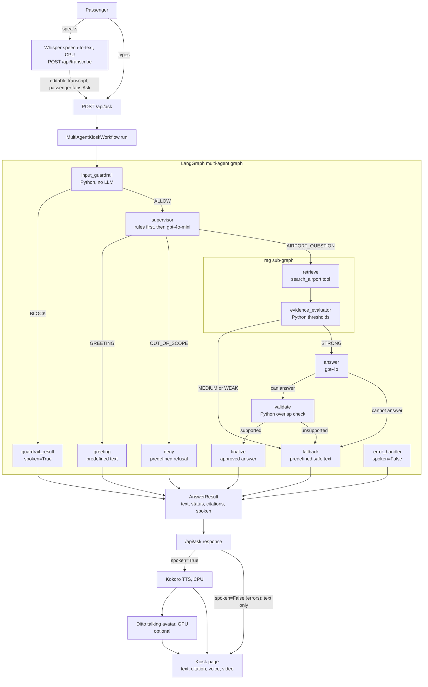
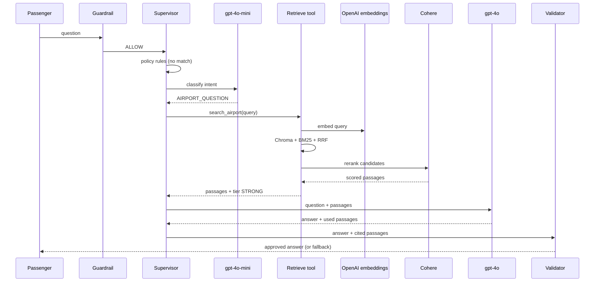

# Technical Architecture: Dam AI Talking Avatar Kiosk (MVP1)

This document describes how one passenger question travels through the kiosk, which component
handles each step, where an LLM is (and is not) called, and how failures are contained. It
describes what is built in the repository today. Items that are not built are listed in
[Out of scope and extension points](#12-out-of-scope-and-extension-points).

Contents

1. [Purpose and scope](#1-purpose-and-scope)
2. [End-to-end flow](#2-end-to-end-flow)
3. [Tech stack](#3-tech-stack)
4. [The multi-agent graph](#4-the-multi-agent-graph)
5. [Agent and component catalogue](#5-agent-and-component-catalogue)
6. [Tools](#6-tools)
7. [Every LLM and external API call](#7-every-llm-and-external-api-call)
8. [AgentState reference](#8-agentstate-reference)
9. [Routing, response status and the `spoken` rule](#9-routing-response-status-and-the-spoken-rule)
10. [Error handling, security and privacy](#10-error-handling-security-and-privacy)
11. [Observability and configuration](#11-observability-and-configuration)
12. [Out of scope and extension points](#12-out-of-scope-and-extension-points)
13. [Rollback](#13-rollback)

---

## 1. Purpose and scope

The kiosk answers questions about the fictional **Dam International Airport** from a closed set of
approved documents (`data/*.md`). The core rule is that every factual claim must trace back to a
retrieved passage; anything the documents do not support is refused or answered with a safe
fallback ("I can't confirm that...").

The workflow is a **LangGraph multi-agent graph** (`app/agents/`). Each agent is a small node with
one job and a typed contract (`AgentState`). The agents reuse, unchanged, the earlier building
blocks: `Router`, `ResponseBook`, `HybridRetriever`, `EvidenceAssessor`, `OpenAIAnswerGenerator`
and `CitationOverlapValidator`.

MVP1 scope: English only, stateless per turn, one airport knowledge base.

---

## 2. End-to-end flow



Any node that raises is captured by `safe_node`; the next conditional edge (wrapped by `guard`)
then routes to `error_handler`. That edge is omitted from the diagram to keep it readable.

What the browser sees: `/api/ask` returns the text immediately. If `spoken` is true and speech is
available it also returns `audio_url` (and `video_url` when the avatar is on) that the page polls.
If `spoken` is false both URLs are `null` and the page just shows the text.

---

## 3. Tech stack

| Layer | Choice | Where |
|---|---|---|
| Web server | FastAPI + Uvicorn (binds to 127.0.0.1, no authentication) | `app/main.py`, `app/api.py` |
| Orchestration | LangGraph 0.2.60 (`StateGraph`, compiled sub-graph, `MemorySaver`) | `app/agents/` |
| LangChain pieces | `langchain-core` `@tool`; `langchain-openai` `ChatOpenAI` for the classifier | `tools.py`, `supervisor.py` |
| Intent classifier | OpenAI `gpt-4o-mini` (setting `OPENAI_CLASSIFIER_MODEL`) | `supervisor.py` |
| Answer generation | OpenAI `gpt-4o` via the `openai` SDK (JSON mode, temperature 0) | `app/workflow/answer.py` |
| Embeddings | OpenAI `text-embedding-3-small` (1536 dimensions) | `app/retrieval/embedding.py` |
| Dense search | ChromaDB persistent store, cosine | `app/retrieval/store.py` |
| Sparse search | BM25 (`rank-bm25`), pickled index | `app/retrieval/sparse.py` |
| Fusion | Reciprocal Rank Fusion | `app/retrieval/retrievers.py` |
| Reranking | Cohere `rerank-v3.5` | `app/retrieval/retrievers.py` |
| Speech to text | `faster-whisper` (`small.en`, int8, CPU) | `app/speech_to_text/` |
| Text to speech | Kokoro-82M (CPU) | `app/text_to_speech/` |
| Talking avatar | Ditto (GPU, separate conda env, warm worker) | `app/avatar/`, `scripts/ditto_worker.py` |
| Frontend | Plain HTML, CSS and JavaScript | `app/ui/` |
| Config | `pydantic-settings` + `.env`; JSON for policy, wording, thresholds | `config/` |
| Tests | `pytest` | `tests/`, `tests/agents/` |

No new Python packages were added for the multi-agent graph; `langgraph`, `langchain` and
`langchain-openai` were already pinned in `requirements.txt`.

---

## 4. The multi-agent graph

Defined in `app/agents/graph.py` (`MultiAgentKioskWorkflow`). Node names are the strings used in
the graph and in `TurnTrace.stage_ms`.

### Nodes

| Node | Module | Kind | LLM call |
|---|---|---|---|
| `guardrail` | `guardrail.py` | Python | none |
| `guardrail_result` | `guardrail.py` | Python | none |
| `supervisor` | `supervisor.py` | Python rules, then LLM | gpt-4o-mini, only for the rules' catch-all |
| `greeting` | `supervisor.py` | Python | none |
| `deny` | `supervisor.py` | Python | none |
| `rag` (sub-graph: `retrieve`, `evidence_evaluator`) | `rag_subgraph.py` | Python + API calls | none (embedding and rerank APIs only) |
| `answer` | `answer_agent.py` | LLM | gpt-4o |
| `validate` | `validation_agent.py` | Python | none |
| `finalize` | `answer_agent.py` | Python | none |
| `fallback` | `validation_agent.py` | Python | none |
| `error_handler` | `validation_agent.py` | Python | none |

The terminal node is called `error_handler` rather than `error` because LangGraph does not allow
a node to share its name with a state key, and `error` is a state key.

### Conditional edges

Every conditional edge is wrapped by `guard`: if `state["error"]` is set, it returns
`error_handler` before the normal rule runs.

| From | Condition | To |
|---|---|---|
| `guardrail` | `guardrail_status == "BLOCK"` | `guardrail_result` |
| `guardrail` | otherwise | `supervisor` |
| `supervisor` | `decision.route == GREETING` | `greeting` |
| `supervisor` | `decision.route == OUT_OF_SCOPE` | `deny` |
| `supervisor` | `decision.route == AIRPORT_QUESTION` | `rag` |
| `rag` | `tier == STRONG` | `answer` |
| `rag` | `tier` is MEDIUM or WEAK | `fallback` |
| `answer` | `generated.can_answer` is true | `validate` |
| `answer` | model said it cannot answer | `fallback` |
| `validate` | `validation.supported` is true | `finalize` |
| `validate` | not supported | `fallback` |

`guardrail_result`, `greeting`, `deny`, `finalize`, `fallback` and `error_handler` all go to `END`.

### The RAG sub-graph

`build_rag_subgraph` compiles `START -> retrieve -> evidence_evaluator -> END` and the main graph
adds it as the single node `rag`. If `retrieve` fails, the sub-graph skips grading and ends; the
main graph's `guard` then routes the turn to `error_handler`.

### Statelessness

A `MemorySaver` checkpointer is attached, but each call to `run` uses a fresh random `thread_id`
and deletes that thread in a `finally` block. No history is passed to any prompt and no state
(including question text) survives the turn. The checkpointer is infrastructure for a later
multi-turn version.

---

## 5. Agent and component catalogue

### 5.1 Input guardrail (`guardrail.py`), Python, no LLM

Runs first on every turn. Four checks, in this order; the first failure blocks the turn.

| # | Check | Reason code | How |
|---|---|---|---|
| 1 | Empty input | `EMPTY_INPUT` | text is empty or whitespace only |
| 2 | Length | `INPUT_TOO_LONG` | `len(text) > settings.max_question_chars` (default 500), measured on the raw text |
| 3 | Prompt injection | `PROMPT_INJECTION` | compiled regexes on normalized text: "ignore / forget / disregard / override" + a target word + "instructions / rules / prompt", "system prompt", asking to reveal "your" instructions, "new instructions", developer/admin/debug mode, fake `<system>` or `[INST]` markers |
| 4 | Jailbreak | `JAILBREAK` | "you are now a/an/my/free/DAN...", "act as" followed by a persona word (different, unrestricted, evil...), "pretend you are", "roleplay as", "do anything now", "DAN mode", "jailbreak", "bypass your rules/safety/filters" |

Text is normalized before matching (Unicode NFKC, lower case, zero-width characters removed,
apostrophes removed, spaces collapsed). The patterns are written to avoid blocking normal airport
questions (for example "Show me the rules for liquids" and "Does the family lane act as a fast
track?" are allowed; `tests/agents/test_guardrail.py` covers these).

A block produces `ResponseStatus.REFUSED` with `spoken=False`. The wording comes from the
`guardrail` block of `config/responses.json`. The guardrail never logs or echoes the question.

Not included: PII detection or masking (Presidio was deliberately left out of MVP1).

### 5.2 Supervisor (`supervisor.py`), hybrid

1. **Rules.** `Router` (`config/policy.json`) checks greeting patterns (whole utterance) and ten
   denied topics (flight status, live gate, visa, medical, fit to fly, fares, rebooking, other
   airports, items left on aircraft, weather). A match is final and costs no LLM call.
2. **Classifier.** Only when the rules return their `AIRPORT_QUESTION` catch-all, `gpt-4o-mini`
   (`ChatOpenAI(...).with_structured_output(IntentClassification)`, temperature 0) returns
   `AIRPORT_QUESTION` or `OUT_OF_SCOPE`. The question is sent as a separate human message and the
   system prompt tells the model it is untrusted text.

Design rule: the classifier can add a refusal but can never override a rule-based decision, which
keeps sensitive denials independent of a model.

Fail-safe: if the classifier call fails or times out, the turn is treated as `AIRPORT_QUESTION`.
Sensitive topics were already denied by the rules, and the route is still gated by retrieval
evidence (STRONG only) and answer validation, so an outage degrades to a safe fallback instead of
taking the kiosk offline. Only the exception type is logged.

### 5.3 Greeting and Deny nodes (`supervisor.py`), Python, no LLM

Plain graph nodes reached by conditional edges (not LLM-bound tools). `greeting` returns the
approved greeting, thanks or goodbye text. `deny` returns the approved refusal for the denied
category, or the `out_of_scope` refusal when the classifier declined. Both are `spoken=True`.

### 5.4 Airport RAG sub-graph (`rag_subgraph.py`)

* `retrieve`: calls the `search_airport` tool (see section 6) under the per-node timeout, then
  rebuilds typed `RetrievedPassage` objects and records `rerank_applied`.
* `evidence_evaluator`: `EvidenceAssessor.assess` grades the passages from the top rerank score
  against `config/evidence_thresholds.json`: STRONG, MEDIUM or WEAK. No passages is WEAK. If the
  Cohere rerank did not run, the tier is capped at MEDIUM because the scores are on a different
  scale. Thresholds are placeholders (`calibrated: false`) until `scripts/calibrate_evidence.py`
  is run; `/health` reports `evidence_calibrated`.

The retrieval pipeline behind the tool (`HybridRetriever`): embed the query, ChromaDB dense search,
BM25 sparse search, RRF fusion, Cohere rerank, then return the top `ANSWER_PASSAGES` (default 5)
passages that have a citable source.

### 5.5 Answer agent (`answer_agent.py`), LLM

`answer_node` calls `OpenAIAnswerGenerator.generate` (gpt-4o, JSON mode, temperature 0). The model
sees only the numbered passages and the question and returns
`{"can_answer", "answer", "used_passages"}`. It has no tool binding. `generated.used` is mapped to
`cited` passages; out-of-range indices are ignored.

### 5.6 Validation agent (`validation_agent.py`), Python, no LLM

`CitationOverlapValidator`: every token containing a digit (gate codes, times, phone numbers) in
the answer must appear verbatim in the cited passages, and each substantive sentence must have at
least 60 percent of its content words present in them. It reliably catches invented specifics and
drift. It cannot catch a negation flip; the `Validator` protocol is the slot for a stronger
validator (Jev).

### 5.7 Finalize, Fallback and Error nodes

| Node | Result status | `spoken` | Notes |
|---|---|---|---|
| `finalize` | `ANSWERED` | true | de-duplicated citations by (source, chunk), keeps the evidence tier |
| `fallback` | `FALLBACK` | true | approved "I can't confirm that..." wording, keeps the tier |
| `error_handler` | `ERROR` | false | approved error wording; not wrapped by `safe_node` so it cannot fail |

Unvalidated model text is never returned: `finalize` is only reachable through the `validate`
node's "supported" edge.

---

## 6. Tools

One tool exists: **`search_airport`** (`app/agents/tools.py`), a LangChain `@tool`.

| | |
|---|---|
| Input | `query: str` |
| Output | `{"passages": [{"chunk_id", "text", "source", "score"}, ...], "rerank_applied": bool}` |
| Runs | `AirportSearch.search_airport` (hybrid retrieval, section 5.4) |
| Called by | the `retrieve` node via `tool.invoke({"query": ...})` |

The tool has a typed schema and description, so it could be bound to a model later. By design no
LLM is bound to it in MVP1: retrieval is a fixed step, and the answer agent receives the passages.

Two forms exist: the module-level `search_airport` (wired once with `configure_search`, raises
`RuntimeError` if not configured) and `make_search_tool(search)`, which binds a tool to one
`AirportSearch`. The workflow uses the bound form so two workflows in one process never share
state; `build_services()` also calls `configure_search` for the module-level tool.

Greeting and Deny are deliberately graph nodes, not tools, because they need no model reasoning.

---

## 7. Every LLM and external API call

| Call | Model / service | Made by | When it happens | When it does NOT happen |
|---|---|---|---|---|
| Intent classification | OpenAI `gpt-4o-mini` | `supervisor` | the rules matched nothing (the catch-all) | guardrail block; greeting; any policy denial; no classifier configured |
| Query embedding | OpenAI `text-embedding-3-small` | `retrieve` (via the tool) | AIRPORT_QUESTION turns | everything else |
| Dense and sparse search | ChromaDB, BM25 (local) | `retrieve` | AIRPORT_QUESTION turns | everything else |
| Rerank | Cohere `rerank-v3.5` | `retrieve` | AIRPORT_QUESTION turns with candidates | everything else; on failure the fused order is used and the tier is capped at MEDIUM |
| Answer generation | OpenAI `gpt-4o` | `answer` | evidence tier is STRONG | MEDIUM or WEAK evidence; any earlier block, greeting or denial |
| Speech to text | `faster-whisper` (local) | `/api/transcribe` | voice input only | typed input |
| Speech synthesis | Kokoro (local) | `/api/ask` background task | `spoken=True` | `spoken=False` |
| Talking head | Ditto (local GPU) | `/api/ask` background task | `spoken=True` and avatar enabled | `spoken=False`, avatar off |

Network calls per turn:

| Turn type | gpt-4o-mini | gpt-4o | Embedding | Cohere |
|---|---|---|---|---|
| Guardrail block | 0 | 0 | 0 | 0 |
| Greeting | 0 | 0 | 0 | 0 |
| Denied by policy rule | 0 | 0 | 0 | 0 |
| Denied by the classifier | 1 | 0 | 0 | 0 |
| Airport question, weak or medium evidence | 1 | 0 | 1 | 1 |
| Airport question, strong evidence | 1 | 1 | 1 | 1 |

Each call has a timeout: the classifier, the retrieval tool and the answer generator run through
`TimeoutRunner` using `NODE_TIMEOUT_SECONDS` (default 30 s), and the OpenAI clients are created
with the same timeout and one retry.



(In the diagram the nodes are shown as one lifeline for readability; in the code they are separate
graph nodes.)

---

## 8. AgentState reference

`app/agents/state.py`. A `TypedDict(total=False)`: nodes return partial dicts that LangGraph merges.

| Key | Type | Written by | Meaning |
|---|---|---|---|
| `request` | `KioskRequest` | `run()` | session id, text, input type, language |
| `guardrail_status` | `str` | `guardrail` | `"ALLOW"` or `"BLOCK"` |
| `guardrail_reason` | `str` | `guardrail` | `EMPTY_INPUT`, `INPUT_TOO_LONG`, `PROMPT_INJECTION`, `JAILBREAK` |
| `decision` | `RouteDecision` | `supervisor` | route (greeting, out_of_scope, airport_question) and category |
| `passages` | `list[RetrievedPassage]` | `retrieve` | reranked chunks with source and score |
| `rerank_applied` | `bool` | `retrieve` | false when the Cohere rerank failed |
| `tier` | `EvidenceTier` | `evidence_evaluator` | STRONG, MEDIUM or WEAK |
| `generated` | `GeneratedAnswer` | `answer` | `can_answer`, `text`, `used` indices |
| `cited` | `list[RetrievedPassage]` | `answer` | the passages the answer relied on |
| `validation` | `ValidationResult` | `validate` | `supported`, `reason` |
| `result` | `AnswerResult` | terminal nodes | the approved response handed to the API |
| `error` | `ErrorState` | `safe_node` | stage and exception type name (never its text) |
| `timings` | `dict[str, float]` | `safe_node` | milliseconds per node |

All value types are the existing contracts in `app/workflow/` (`contracts.py`, `routing.py`,
`answer.py`, `validation.py`).

---

## 9. Routing, response status and the `spoken` rule

| Path | `ResponseStatus` | `spoken` | TTS and avatar | Text on screen |
|---|---|---|---|---|
| Guardrail block (`guardrail_result`) | `REFUSED` | true | yes (concierge clip) | yes |
| Greeting | `GREETING` | true | yes | yes |
| Denied by rule or classifier | `REFUSED` | true | yes | yes |
| Answered (`finalize`) | `ANSWERED` | true | yes | yes, with source |
| Fallback | `FALLBACK` | true | yes | yes |
| Error | `ERROR` | false | skipped | yes |

`/api/ask` creates `audio_url` only when `result.spoken` is true and a synthesizer exists, and
`video_url` only when the avatar is on. With `spoken=false` the response has `audio_url: null` and
`video_url: null` (only errors are `spoken=false` now; verified over HTTP in
`tests/agents/test_api_integration.py`). The page code (`app/ui/kiosk.js`) shows the text and only
fetches audio or video when those URLs are present; that browser behaviour was read from the code,
not exercised in a browser during this work.

Fixed phrases (greeting, thanks, goodbye, fallback, the refusals including `out_of_scope`, and
the four guardrail messages) are picked up by the clip pre-renderer (`app/avatar/clips.py`).
Wording shared by two names (the injection and jailbreak messages) is rendered once. The error
text is not, because it is never spoken.

Which face speaks a turn (`face_for_turn` in `app/api.py`):

| Turn | Face |
|---|---|
| A fixed phrase (greeting, thanks, goodbye, fallback, refusal, guardrail message) | always the default concierge: the cached clip if it exists, otherwise a live concierge render |
| A grounded answer (`ANSWERED`) | the traveler's own photo if the session has one, else the concierge, rendered live |

Only the concierge has pre-rendered clips; nothing is ever rendered ahead of time for a traveler's
photo. At server start the missing concierge clips are rendered (`CLIPS_PRERENDER_ON_START`) and
`Services.clips_status()` reports `warming`, `ready` or `degraded` (`/health` `components.clips`,
`GET /api/clips/status`). The kiosk page shows "Warming up... n of m ready" and takes no questions
while `warming`.

---

## 10. Error handling, security and privacy

### Error containment

| Mechanism | What it does |
|---|---|
| `safe_node(stage, fn)` | wraps every node; an exception becomes `state["error"]` (stage + exception type) and the duration is recorded |
| `guard(chooser)` | wraps every conditional edge; a state with `error` goes to `error_handler` |
| `TimeoutRunner` | enforces `NODE_TIMEOUT_SECONDS` on the classifier, retrieval and answer calls |
| `error_handler` | returns the approved error wording as text only |
| `run()` | catches even a graph crash and returns a safe `ERROR` result; it never raises |

### Security

* The server has no authentication and is meant for `127.0.0.1`. Do not expose the port without
  adding authentication and TLS.
* All API keys stay server-side and no endpoint returns them.
* The question is treated as untrusted text everywhere: the guardrail screens it, the classifier
  and the answer prompt both instruct the model to ignore instructions inside it, and the answer
  is only released after the validator accepts it.
* Sensitive refusals are decided by deterministic rules, never by the classifier alone.
* The regex guardrail is a first line of defence, not a guarantee (for example it does not map
  look-alike letters from other scripts). The evidence and validation gates are independent.
* In the HTTP path, `/api/ask` already rejects blank text and text over `MAX_QUESTION_CHARS` with a
  422, so `EMPTY_INPUT` and `INPUT_TOO_LONG` mainly protect other callers of the workflow.

### Privacy

* No question text in logs or in `TurnTrace`; failures log the exception type only.
* The checkpointer thread is deleted at the end of every turn.
* Traveler audio is never written to disk; traveler photos stay local and last for one session
  (see the README).

---

## 11. Observability and configuration

### TurnTrace and logs

`TurnTrace` (`app/workflow/contracts.py`) holds: `session_id`, `route`, `evidence_tier`, `status`,
`latency_ms`, `validator`, `error_stage`, `stage_ms` (per-node milliseconds) and
`guardrail_reason` (new, set only when the guardrail blocked). Each turn logs one line:

```
turn session=<id> route=<route> tier=<tier> status=<status> guardrail=<reason> latency_ms=<ms> stages={...}
```

`GET /health` returns the components `workflow`, `transcriber`, `synthesizer`,
`evidence_calibrated`, `avatar` (when enabled) and `agent_graph` (`"multi_agent"` for this
workflow; absent for the legacy one).

### Configuration

| Setting (env var) | Default | Used by |
|---|---|---|
| `OPENAI_API_KEY`, `COHERE_API_KEY`, `TYPESAFE_API_KEY` | none, required | all LLM and API calls (the TypeSafe key is required but Jev is not used yet) |
| `OPENAI_CHAT_MODEL` | `gpt-4o` | answer agent |
| `OPENAI_CLASSIFIER_MODEL` | `gpt-4o-mini` | supervisor classifier (new) |
| `MAX_QUESTION_CHARS` | 500 | guardrail length check |
| `NODE_TIMEOUT_SECONDS` | 30 | classifier, retrieval and answer calls |
| `ANSWER_PASSAGES` | 5 | passages given to gpt-4o |
| `POLICY_PATH` | `config/policy.json` | rule-based routing |
| `RESPONSES_PATH` | `config/responses.json` | approved wording, including the `guardrail` block |
| `EVIDENCE_THRESHOLDS_PATH` | `config/evidence_thresholds.json` | STRONG / MEDIUM cut-offs |
| `DENSE_TOP_K`, `SPARSE_TOP_K`, `RRF_K`, `HYBRID_TOP_K`, `RERANKER_TOP_K` | see `config/settings.py` and `.env.example` | retrieval |

Wording lives in `config/responses.json` per language: `greeting`, `thanks`, `goodbye`,
`fallback`, `error`, `refusal.<category>` (now including `out_of_scope`) and the new
`guardrail.<REASON_CODE>` block.

---

## 12. Out of scope and extension points

Not built in MVP1:

* **PII detection and masking** (Presidio). Deliberately excluded.
* **Multi-language input and output** (Hindi, Spanish). Planned for MVP2.
* **Conversation memory.** The checkpointer is wired but history is not used.
* **Jev (TypeSafe) validation.** The deterministic validator is used; `TYPESAFE_API_KEY` is still
  required by settings.
* **LLM tool-calling for retrieval.** `search_airport` is a tool but no model is bound to it.

Extension points:

| Change | Where |
|---|---|
| Add Jev as the primary validator | implement the `Validator` protocol in `app/workflow/validation.py` and pass it to `MultiAgentKioskWorkflow(validator=...)`; keep `CitationOverlapValidator` as the fallback |
| Add a language (MVP2) | add a language block to `policy.json` and `responses.json` (`GuardrailResponses` and `ResponseBook` already resolve by language with a default fallback); also needed: guardrail regexes and the classifier prompt for that language, a multilingual Whisper model, a TTS voice that supports the language, and re-calibrated evidence thresholds. `language` is already carried in `KioskRequest` and `AgentState`. |
| Let a model call retrieval | bind `search_airport` to a chat model and add a `ToolNode`; the tool already has a typed schema |
| Add a denied topic | add a rule to `config/policy.json` and a refusal to `config/responses.json` (no code change) |

---

## 13. Architecture notes

The multi-agent LangGraph workflow (`MultiAgentKioskWorkflow` in `app/agents/graph.py`) is the
sole workflow implementation. Data contracts, routing, evidence assessment, answer generation and
validation all live in `app/workflow/` and `app/retrieval/` and are consumed by the agents package.
